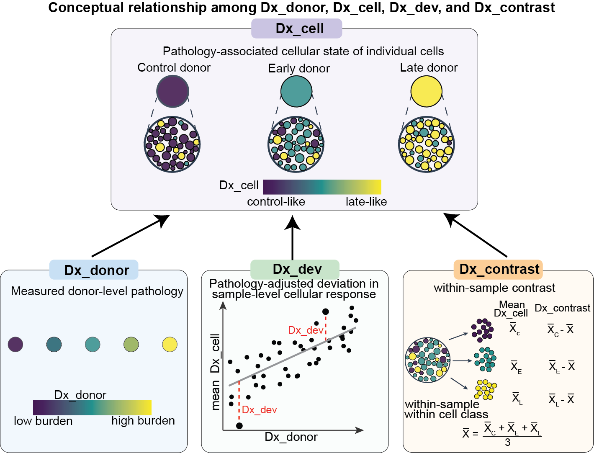

# PsychAD snMultiome

**Analysis code for _Coordinated cellular responses track cognitive outcomes in Alzheimer's disease_**

This repository contains the analysis workflows associated with the PsychAD single-nucleus multiome study. We profiled paired gene expression (snRNA-seq) and chromatin accessibility (snATAC-seq) in approximately **1.42 million nuclei** from **three cortical regions** across **247 donors**, and examined how cellular molecular states relate to Alzheimer's disease (AD) neuropathology and cognitive outcomes.

## Repository organization

```text

PsychAD-snMultiome/
├── 01_taxonomy/
│   ├── 01_metadata/              # Sample/donor metadata and Dx_donor construction
│   ├── 02_preprocessing/         # Ambient RNA correction, QC, and doublet removal
│   ├── 03_taxonomy/              # RNA/ATAC-based cell-type annotation and taxonomy refinement
│   └── 04_motif_classify/        # TF motif-based subclass classification
│
├── 02_cellular_disease_score/    # Dx_cell model training, validation, and projection
│
├── 03_differential_analysis/
│   ├── 01_conventional/         # Conventional pseudobulk analysis and variance partitioning
│   ├── 02_Dx_decomposed/        # Dx_cell-state-resolved pseudobulk differential analysis
│   └── 03_regulon_prioritization/ # TF prioritization integrating expression, motif activity, and GRNs
│
├── 04_Dx_dev_donor_axes/
│   ├── 01_Dx_dev/              # Estimation of cell-class-specific pathology-adjusted responses
│   ├── 02_donor_axes/          # Identification of donor-associated transcriptional programs
│   ├── 03_external/            # External validation of Dx_dev and donor-associated axes
│   └── 04_summary/             # Associations with molecular, cellular, and clinical phenotypes
│
└── 05_demo/                     # Demonstrations using external datasets and pretrained models
```

## Conceptual overview of disease-related measurements


<p align="center">
  
</p>

**Figure 1 | Conceptual relationships among disease-associated measurements across analytical scales.** Dx_cell is a pathology-supervised transcriptomic score that positions individual cells along a continuum of disease-associated states, from control-like to late-like. Variation in Dx_cell can be characterized across three complementary scales. First, Dx_donor summarizes independently measured neuropathological burden, capturing pathology-associated differences in cellular states across donors. Second, Dx_dev quantifies deviations in sample-level mean Dx_cell from values expected based on Dx_donor and other covariates, capturing pathology-adjusted differences in cellular responses between samples. Third, Dx_contrast captures within-sample heterogeneity by centering the mean Dx_cell of control-like, early-like, and late-like pseudobulk groups within each sample and cell class. Unlike the group-level mean Dx_cell, which retains pathology-associated and pathology-adjusted between-sample variation, Dx_contrast removes shared additive sample-level effects and isolates relative differences among coexisting cellular states. Together, these complementary measurements distinguish disease-associated variation across donor, sample, and within-sample cellular-state scales.

### Key measurements

| Measurement | Analytical level | Interpretation |
| --- | --- | --- |
| **`Dx_cell`** | Individual cell; averaged within pseudobulk groups | RNA-derived, pathology-supervised cellular disease-state score. Group-level averages retain between-sample pathology-associated and pathology-adjusted variation. |
| **`Dx_donor`** | Donor / sample pathology | Score summarizing measured AD neuropathological burden; used as supervision for the `Dx_cell` model. |
| **`Dx_dev`** | Sample × cell class | Pathology-adjusted deviation in mean `Dx_cell`, estimated using the specified regression model and covariates. |
| **`Dx_contrast`** | Dx-decomposed group within sample × cell class | Group-level mean `Dx_cell` centered relative to the other decomposed groups in the same sample and cell class. |

## Data and model availability

| Resource | Contents | Access / status |
| --- | --- | --- |
| [MSSM PsychAD study on Synapse (syn52160016)](https://www.synapse.org/Synapse:syn52160016) | Raw and processed RNA/ATAC data, associated metadata and complete differential-analysis results | **Data submission in progress.** |
| [PsychAD snMultiome UCSC Cell Browser](https://cells.ucsc.edu/?ds=psychad-snmultiome) | Interactive exploration of processed single-nucleus data and available annotations | Interactive browser (will be avaliable soon) |
| [Frozen Dx_cell models on Zenodo](https://zenodo.org/records/23190790) | Frozen model artifacts intended for reuse or projection of `Dx_cell` | Model record |


<!-- ### Differential expression and chromatin accessibility results 

The **complete DEG and DAC results will be shared through Synapse**, rather than duplicated as large tables in GitHub. Where possible, these files will contain **all tested genes or chromatin features**, not just significant hits, with feature identifiers, the tested comparison and cell population, effect estimates, nominal and adjusted P values, and relevant model and annotation information. -->

## citation
Please cite the following:
```
[TBD]
```
## contact
For questions regarding the analysis code, processed data, or computational methods, please contact:\
Pengfei Dong\
Center for Disease Neurogenomics\
Icahn School of Medicine at Mount Sinai\
Email: pengfei.dong@mssm.edu
## License

The source code in this repository is distributed under
the [MIT License](LICENSE).
